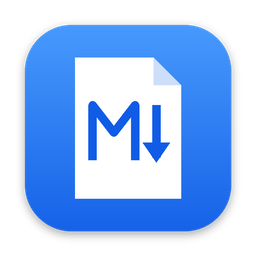
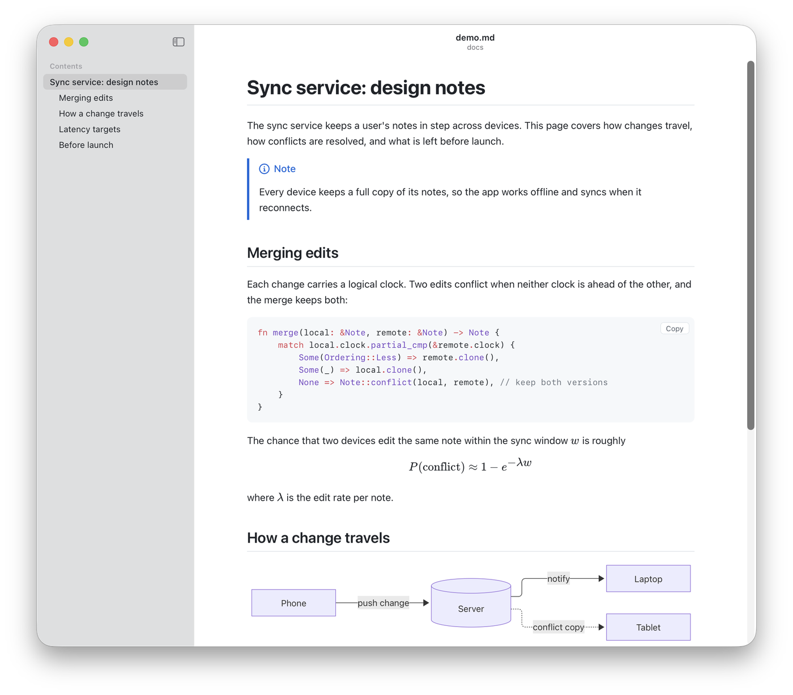
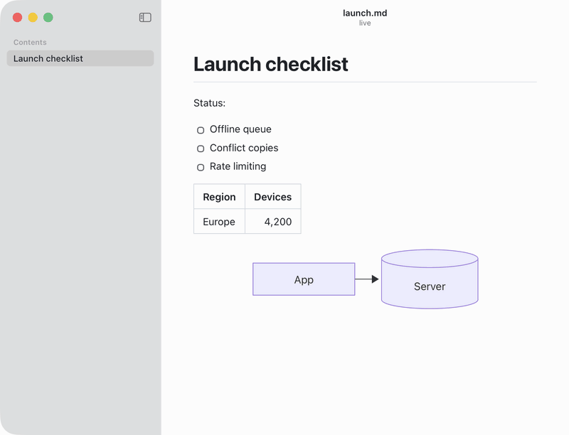
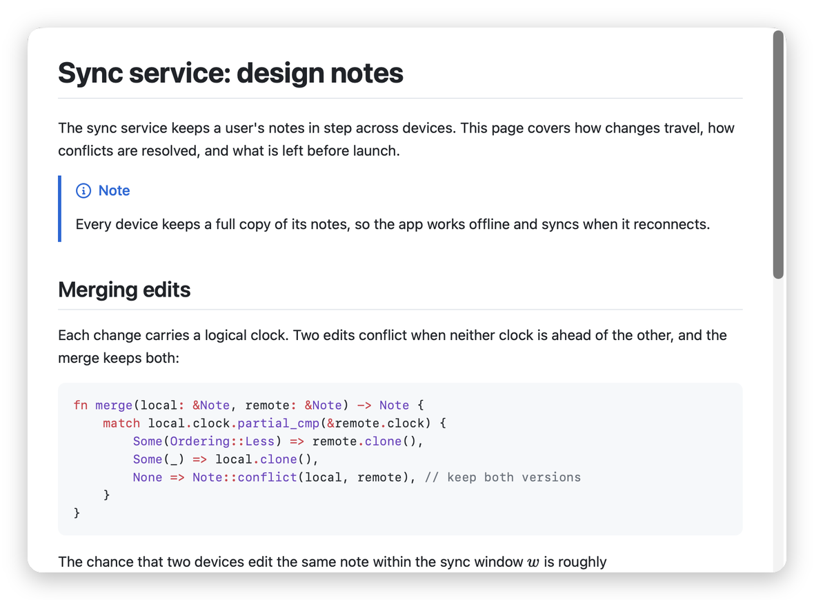

<p align="center"></p>

<h1 align="center">MDViewer</h1>

<p align="center">
  A fast, native Markdown viewer for macOS, with Quick Look previews, live reload, diagrams and math.<br>
  Free and open source.
</p>

<p align="center">
  <a href="https://github.com/mmmikael/mdviewer/releases/latest"><strong>Download for macOS</strong></a>
  · Apple silicon and Intel · macOS 13 or later
</p>

<picture>
  <source media="(prefers-color-scheme: dark)" srcset="docs/images/screenshot-dark.png">
  
</picture>

## Why MDViewer

- **Feels like a Mac app.** Native windows, tabs and menus, a translucent sidebar with the table of contents, light and dark mode. A 7 MB download that opens instantly.
- **Live reload.** Keep it next to your editor, or next to the AI tool writing your docs: every save shows up right away, and you keep your place.
- **Quick Look.** Press space on a `.md` file in Finder for a rendered preview, diagrams and math included.
- **Renders what GitHub renders.** Tables, task lists, footnotes, alerts, front matter, syntax highlighting for 200+ languages, Mermaid diagrams, KaTeX math, and local images.
- **Share it.** Export as PDF or as a single self-contained HTML file, or copy as rich text to paste into Mail, Google Docs or Slack.
- **Private and safe.** No accounts, no tracking. Documents can't run scripts, and the app only reads the files you open and the images they show.

### Live reload



### Quick Look

Select a Markdown file in Finder and press the space bar:



### How it compares

| | MDViewer | Marked 2 | Typora | [MacDown 3000](https://github.com/schuyler/macdown3000) |
|---|---|---|---|---|
| What it is | Viewer | Previewer | Editor | Editor with preview |
| Price | Free | Paid | Paid | Free |
| Open source | Yes | No | No | Yes |

MDViewer is for reading: you write Markdown in your own editor (or let your tools write it) and read it here. If you'd rather edit in the same app, Typora or MacDown 3000 (the maintained continuation of MacDown) are good choices.

Where MDViewer differs from MacDown 3000:

| | MDViewer | MacDown 3000 |
|---|---|---|
| Quick Look preview | Diagrams, math and highlighted code | Math as plain text; diagrams and code as plain code blocks |
| GitHub alert boxes (`> [!NOTE]`) | Yes | No |
| Copying for Mail, Docs or Slack | Formatted text, of the whole document or just the selection | HTML source of the whole document |
| Opening a file | Straight to the rendered page | Editor with a preview pane |

### All features

- Opens `.md` files from Finder, the Dock, drag and drop, ⌘O, Open Recent and `open -a MDViewer file.md`; can be made the default app for Markdown from Settings
- Find in page, zoom, back and forward between linked documents; hovering a link shows where it goes, like Safari
- Print, Export as PDF, Export as HTML, Copy as Rich Text
- Links to other Markdown files open in the app; links to websites open in your browser

## Install

Requires macOS 13 or later.

1. Download the `.dmg` for your Mac from the [latest release](https://github.com/mmmikael/mdviewer/releases/latest):
   - **Apple silicon** (M1 and later): `MDViewer_<version>_aarch64.dmg`
   - **Intel:** `MDViewer_<version>_x64.dmg`
   - **Not sure?** `MDViewer_<version>_universal.dmg` works on both, but is bigger. Apple menu ▸ About This Mac shows which chip you have.
2. Open it and drag **MDViewer** to **Applications**.
3. Open MDViewer. Releases aren't notarised by Apple yet, so the first time macOS blocks it: go to **System Settings ▸ Privacy & Security**, scroll down and click **Open Anyway**. You only need to do this once.
4. To open Markdown files with MDViewer when you double-click them, choose **MDViewer ▸ Settings…** and click **Make Default**.

## Development

MDViewer is built with [Tauri 2](https://v2.tauri.app) (Rust) and Svelte 5. See [PLAN.md](PLAN.md) for the design and the reasoning behind it.

Requirements: Rust (1.89+), Node 22+, pnpm, Xcode command line tools.

```bash
pnpm install
```

```bash
pnpm tauri dev
```

Open a file at startup: `pnpm tauri dev -- -- "$PWD/tests/fixtures/rich.md"`. Frontend changes hot-reload; Rust changes rebuild and restart the app.

**UI in a browser:** while `pnpm dev` (or `tauri dev`) runs, open <http://127.0.0.1:1420/?file=rich.md> in any browser. Tauri's IPC is mocked by `src/dev/mockTauri.ts` (dev builds only). Use `?window=settings` for the Settings window, and `mdv.menu("find")` / `mdv.edit("# new content")` in the console to simulate menu actions and file changes.

| Script | What it does |
|---|---|
| `pnpm test` | Vitest: Markdown pipeline, sanitising, links, images, TOC, find |
| `cargo test --manifest-path src-tauri/Cargo.toml` | Rust: document registry, file reading, settings, watcher matching |
| `pnpm lint` | `svelte-check`, `cargo fmt --check`, `cargo clippy -D warnings` |
| `pnpm tauri:build` | Release `.app` and `.dmg` for this Mac's architecture |
| `pnpm tauri:build:universal` | Universal (Apple silicon + Intel) build; needs `rustup target add x86_64-apple-darwin` |

Build output: `src-tauri/target/release/bundle/` (about 8 MB app, 6 MB DMG).

## Quick Look extension

`quicklook/` holds a small Quick Look preview extension (Swift, no Xcode project). `quicklook/build.sh` builds the preview page from `src/quicklook/` (the app's Markdown pipeline with a bundled subset of languages; Mermaid's single-file build is shipped next to it and loaded only for documents with diagrams), compiles the extension and signs it; `tauri build` runs it before bundling and copies the result into `MDViewer.app/Contents/PlugIns`. To try a build's extension without installing it:

```bash
qlmanage -p tests/fixtures/rich.md
```

## Project layout

```
src/                       Web UI (Svelte 5 + TypeScript)
  DocumentWindow.svelte    Document window: rendering, links, find, zoom, history
  SettingsWindow.svelte    Settings window
  lib/markdown/            markdown-it setup, Shiki, Mermaid, sanitising + DOM post-processing
  lib/export.ts            Standalone HTML export and rich-text clipboard HTML
  lib/ipc.ts               Typed wrappers for Rust commands and events
  quicklook/               Quick Look preview page (main.ts, bundled language subset)
  dev/mockTauri.ts         IPC mocks for running the UI in a browser
src-tauri/src/
  lib.rs                   App setup and lifecycle (Finder opens, Dock reopen, window events)
  documents.rs             Window ↔ file registry, window creation, Open dialog, asset scope
  watcher.rs               File watching (watches the folder, so atomic saves work)
  menu.rs                  Menu bar, Open Recent, menu actions
  settings.rs              Settings and recent files (store plugin)
  export.rs                Export as PDF (WebKit print to file), save panel, rich-text clipboard
  platform.rs              AppKit bits: Dock recents, clipboard, traffic light position
quicklook/                 Quick Look extension: Swift controller, Info.plist, build script
tests/                     Vitest tests and Markdown fixtures
```

## Notes

- **Versions are pinned to Tauri 2.11 / plugin 2.4–2.7** because newer plugin crates need Rust 1.90. Keep the JS packages (`@tauri-apps/*`) on the same minor versions as their Rust crates when upgrading.
- **Title bar:** document windows get an empty unified `NSToolbar` (`platform.rs`), so macOS itself lays out a tall title bar and places the window buttons, as in Mail or Notes. The page asks for their position (`window_chrome`) and lines up its toolbar and sidebar button with them. (Moving the buttons by hand made them jump while resizing.)
- **Security:** documents are sanitised with DOMPurify, scripts never run, the web view can't navigate away from the app, and only folders of opened documents (or their git repository) are readable through the asset protocol. There is no `fs` or `shell` plugin.

## Releasing

Signing and notarisation need an Apple Developer ID certificate. Locally, set `APPLE_SIGNING_IDENTITY` plus either `APPLE_ID`/`APPLE_PASSWORD`/`APPLE_TEAM_ID` or an App Store Connect API key before `pnpm tauri:build`. In CI, pushing a `v*` tag runs `.github/workflows/build.yml`, which creates a draft GitHub release and builds three DMGs for it in parallel: Apple silicon, Intel and universal. It expects the secrets listed in that file. To try the builds without releasing, run the workflow by hand (Actions ▸ Build ▸ Run workflow): the DMGs are then kept as downloadable artifacts of the run.

Unsigned builds work on the machine that built them; other Macs will show a Gatekeeper warning.

## License

[MIT](LICENSE)
