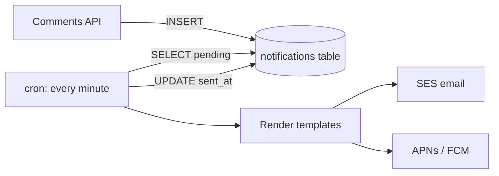
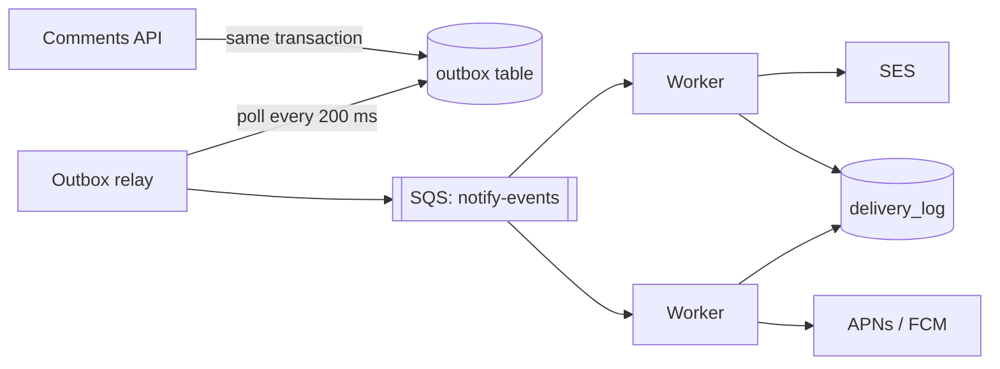

# Notification delivery: investigation and migration plan

> Written by a coding agent after a session on the `notify` service. Everything below was checked against the code on `main` (commit `4f1c2e9`) and the last 30 days of production metrics.

## Context

The `notify` service sends email, push and in-app notifications for comments, mentions, shared documents and billing events. Today it works by **polling**: a cron job runs every minute, selects pending rows from `notifications`, renders them and hands them to the providers (SES for email, APNs and FCM for push).

This was fine at launch. Since the team plan shipped, volume went from about 40,000 to 1.9 million notifications a day, and three problems keep coming back:

1. Notifications arrive late: the p95 delay between the event and delivery is 4 min 10 s, and over 20 minutes during busy hours.
2. Some notifications are sent twice. Support gets about 15 tickets a week about duplicate emails.
3. The cron job sometimes overlaps with itself and locks the `notifications` table, which slows down the comments API.

You asked me to find out why, and to propose a plan to move to an event queue without losing or duplicating notifications during the migration.

## How it works today



The job lives in `services/notify/jobs/deliver.ts`. In short:

```ts
export async function deliverPending() {
  const batch = await db.query(
    `SELECT * FROM notifications
     WHERE sent_at IS NULL AND attempts < 5
     ORDER BY created_at
     LIMIT 5000`,
  );
  for (const n of batch.rows) {
    try {
      await send(n);
      await db.query(`UPDATE notifications SET sent_at = now() WHERE id = $1`, [n.id]);
    } catch (err) {
      await db.query(`UPDATE notifications SET attempts = attempts + 1 WHERE id = $1`, [n.id]);
    }
  }
}
```

Nothing stops two runs from picking the same rows, and `send` happens before `sent_at` is written.

## Findings

### 1. Why notifications are late

- The job takes **at most 5,000 rows per run**, once a minute. At peak we insert 3,800 rows a minute, but rendering a digest email takes 40–120 ms, so a run often takes longer than a minute and the backlog grows.
- Rows are processed **one at a time**. Provider calls are not batched, even though SES and FCM both accept batches.
- Retries go to the back of the same queue, so one slow provider (APNs had a 9-minute incident on the 12th) delays everything behind it.

Measured from the `notify_delivery_delay_seconds` histogram:

| Hour (UTC) | Inserted / min | p50 delay | p95 delay | p99 delay |
|---|---:|---:|---:|---:|
| 03:00 | 310 | 31 s | 58 s | 1 min 20 s |
| 09:00 | 2,900 | 1 min 50 s | 6 min 40 s | 14 min |
| 14:00 | 3,800 | 3 min 05 s | 21 min | 38 min |
| 20:00 | 1,600 | 52 s | 2 min 30 s | 5 min |

### 2. Why some are sent twice

There are two separate causes:

- **Overlapping runs.** When a run takes longer than a minute, cron starts the next one, and both select the same `sent_at IS NULL` rows. This accounts for about 80% of the duplicates in the logs (matching `notification_id` sent within the same minute).
- **Crash between send and update.** If the process is killed after `send(n)` but before the `UPDATE`, the row is sent again on the next run. This happens on every deploy, since deploys don't wait for the job to finish.

From the logs, last 30 days:

| Cause | Duplicates | Share |
|---|---:|---:|
| Overlapping runs | 11,240 | 81% |
| Deploy during a run | 2,380 | 17% |
| Unknown | 270 | 2% |

### 3. Why the comments API slows down

The `UPDATE … attempts = attempts + 1` statements and the big `SELECT … ORDER BY created_at` run against the same table the comments API inserts into. During long runs, autovacuum can't keep up and the index on `(sent_at, created_at)` bloats to 9 GB. I saw insert latency on `POST /comments` go from 12 ms to 180 ms while a run was going.

> [!WARNING]
> The `notifications` table has 410 million rows and no partitioning. Any migration that rewrites it in place will take hours and must not run during the day.

## Options considered

| Option | Fixes delay | Fixes duplicates | Effort | Notes |
|---|---|---|---|---|
| A. Keep cron, add `FOR UPDATE SKIP LOCKED` and batching | Partly | Overlaps only | 2 days | Quick win, but still polls and still hits the hot table |
| B. Postgres `LISTEN/NOTIFY` | Yes | No | 1 week | Messages are lost if no listener is connected |
| C. Managed queue (SQS) with an outbox table | Yes | Yes, with idempotency keys | 3–4 weeks | Standard pattern; we already run SQS for exports |
| D. Kafka | Yes | Yes | 6+ weeks | Overkill for our volume; nobody on the team runs Kafka |

**Recommendation: do A now as a stopgap, then C.** Option A removes most duplicates within days. Option C fixes the root cause and takes delivery load off the hot table.

## Target design



- The API writes an **outbox row in the same transaction** as the comment, so an event can never be lost or published for a comment that was rolled back.
- A small **relay** moves outbox rows to SQS and deletes them. It can publish twice, which is fine because workers are idempotent.
- **Workers** check `delivery_log` before sending, using an idempotency key of `(event_id, channel, recipient_id)`.
- Each channel gets its **own queue and retry policy**, so a slow provider only delays its own messages.

### Data model

```sql
CREATE TABLE outbox (
  id          bigserial PRIMARY KEY,
  event_id    uuid        NOT NULL UNIQUE,
  kind        text        NOT NULL,
  payload     jsonb       NOT NULL,
  created_at  timestamptz NOT NULL DEFAULT now()
);

CREATE TABLE delivery_log (
  event_id     uuid        NOT NULL,
  channel      text        NOT NULL,  -- 'email' | 'push' | 'in_app'
  recipient_id bigint      NOT NULL,
  provider_id  text,
  sent_at      timestamptz NOT NULL DEFAULT now(),
  PRIMARY KEY (event_id, channel, recipient_id)
);
```

`delivery_log` only keeps 30 days (partitioned by day, old partitions dropped), so it stays small.

### Worker logic

```ts
export async function handle(event: NotifyEvent, channel: Channel) {
  for (const recipient of await recipientsFor(event, channel)) {
    const key = { eventId: event.id, channel, recipientId: recipient.id };
    // Claim first: the primary key makes this atomic across workers.
    const claimed = await db.query(
      `INSERT INTO delivery_log (event_id, channel, recipient_id)
       VALUES ($1, $2, $3) ON CONFLICT DO NOTHING RETURNING 1`,
      [key.eventId, key.channel, key.recipientId],
    );
    if (claimed.rowCount === 0) continue; // already sent (or being sent)
    try {
      const providerId = await providers[channel].send(render(event, recipient));
      await db.query(`UPDATE delivery_log SET provider_id = $4 WHERE …`, [/* … */ providerId]);
    } catch (err) {
      await db.query(`DELETE FROM delivery_log WHERE …`, [/* key */]); // let SQS retry it
      throw err;
    }
  }
}
```

Claiming before sending means a crash can cause a *missed* send instead of a duplicate. The delete-on-error path and a nightly reconciliation job (see Phase 4) cover that.

## Migration plan

### Phase 0 — Stopgap (this week)

- [ ] Change the cron query to `SELECT … FOR UPDATE SKIP LOCKED` inside a transaction, so overlapping runs never take the same rows.
- [ ] Batch provider calls: SES `SendBulkEmail` (50 per call), FCM `sendEach` (500 per call).
- [ ] Make deploys wait up to 60 s for a running job (`SIGTERM` handler that finishes the current batch).
- [ ] Add an alert on `notify_delivery_delay_seconds` p95 > 5 min.

Expected result: duplicates down by ~95%, p95 delay under 2 minutes at peak.

### Phase 1 — Outbox (week 2)

- [ ] Create `outbox` and `delivery_log` (new tables, no change to `notifications`).
- [ ] Write outbox rows from the comments, mentions and sharing code paths, **behind the `notify_outbox` flag**.
- [ ] Ship the relay as a separate deployment with 2 replicas; it uses `SKIP LOCKED` too.
- [ ] Dashboards: outbox depth, relay lag, SQS age of oldest message.

### Phase 2 — Workers in shadow mode (week 3)

- [ ] Workers consume from SQS and do everything **except** calling providers; they log what they would have sent.
- [ ] Compare against what cron actually sent, per notification, for 3 days. Target: 100% match on recipients and channels, excluding known cron duplicates.
- [ ] Load test at 3× peak (11,400 events/min) with 8 workers.

### Phase 3 — Switch over, one channel at a time (week 4)

| Day | Channel | Rollout |
|---|---|---|
| Mon | In-app | 10% → 100% |
| Tue | Push | 10% → 50% |
| Wed | Push | 100% |
| Thu | Email | 10% → 50% |
| Fri | — | No changes on Friday |
| Mon | Email | 100% |

For each channel, cron skips notifications whose recipient is in the rollout cohort, so nobody gets both. Rollback is flipping the flag; cron picks up anything the workers haven't claimed.

### Phase 4 — Clean up (week 5)

- [ ] Nightly reconciliation: find outbox events older than 1 hour with no `delivery_log` row for an expected recipient, and re-enqueue them.
- [ ] Turn off the cron job.
- [ ] Stop writing to `notifications.sent_at` and `attempts`; keep the table read-only for the in-app inbox until it moves to `delivery_log`.
- [ ] Archive `notifications` rows older than 90 days to S3, then drop the `(sent_at, created_at)` index.

## Rollout metrics

| Metric | Today | Phase 0 target | Final target |
|---|---:|---:|---:|
| p95 delivery delay (peak) | 21 min | < 2 min | < 10 s |
| Duplicate sends / week | ~3,500 | < 200 | < 10 |
| `POST /comments` p95 during delivery | 180 ms | < 40 ms | < 15 ms |
| Missed sends found by reconciliation / day | unknown | — | < 5 |

## Risks

| Risk | Likelihood | Impact | Mitigation |
|---|---|---|---|
| Outbox writes slow down the comments API | Low | Medium | One small insert per transaction; measured +0.4 ms in staging |
| SQS outage | Low | High | Outbox keeps events; relay resumes where it stopped |
| Missed sends when a worker crashes after claiming | Medium | Medium | Delete-on-error plus nightly reconciliation |
| Template rendering differs between cron and workers | Medium | Low | Shared rendering package; shadow-mode comparison |
| Email provider rate limits at higher throughput | Medium | Medium | Per-channel concurrency limits; SES quota raised to 200/s |

## Open questions

> [!IMPORTANT]
> These need a decision before Phase 1 starts.

1. **Digest emails.** Today, daily digests are built by the same cron job. Should they move to a scheduled worker in this project, or stay on cron until a later one? I recommend keeping them on cron for now; they are 3% of the volume.
2. **Retention of `delivery_log`.** 30 days is enough for deduplication, but support sometimes looks further back. Is 90 days needed? It would be about 120 GB.
3. **Ownership of the relay.** It's tiny, but it pages someone if it stops. Platform team or notifications team?
4. **Quiet hours.** Product asked for "don't push between 22:00 and 07:00 local time". It's easier to add in the new workers than in cron. In scope or not?

## What I did not check

- iOS notification grouping, which depends on the `thread-id` we send to APNs. The new workers must send the same value; I didn't verify the web push path at all.
- Costs: SQS at this volume should be about $40 a month, but I didn't price the extra RDS IOPS for the outbox.
- The `billing` service also inserts into `notifications` directly (in `billing/invoices/notify.py`). It will need the same outbox change, and I haven't looked at that code in detail.

## Test plan

- Unit tests for the worker's claim, send and release logic, including a provider error after claiming.
- An integration test that kills a worker between claim and send, then runs reconciliation and checks the notification is sent exactly once.
- Replay one hour of production events (anonymised) through shadow mode and diff the output against cron.
- Chaos test in staging: stop the relay for 10 minutes at peak load, then check nothing is lost and the backlog drains in under 5 minutes.

## Appendix: log excerpts

Overlapping runs on the 14th:

```text
14:02:00.013 deliver start run=88121 pending=17204
14:03:00.009 deliver start run=88122 pending=17112
14:03:00.412 send email notification_id=5521873 run=88121
14:03:00.418 send email notification_id=5521873 run=88122   <- duplicate
14:03:41.977 deliver end run=88121 sent=5000 failed=12 took=101.9s
```

Deploy during a run:

```text
09:30:12.551 send push notification_id=5487120 run=87310
09:30:12.553 SIGTERM received, exiting
09:31:00.020 deliver start run=87311 pending=9921
09:31:00.507 send push notification_id=5487120 run=87311    <- sent again
```

## Next steps

If you agree with the recommendation, I'll start on Phase 0 today: it's a one-file change plus the deploy hook, and it can ship tomorrow. I'll open a separate PR for the Phase 1 tables so they can be reviewed with the data team.
