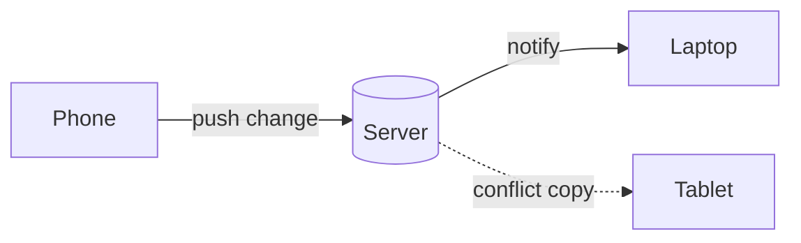

# Sync service: design notes

The sync service keeps a user's notes in step across devices. This page covers how changes travel, how conflicts are resolved, and what is left before launch.

> [!NOTE]
> Every device keeps a full copy of its notes, so the app works offline and syncs when it reconnects.

## Merging edits

Each change carries a logical clock. Two edits conflict when neither clock is ahead of the other, and the merge keeps both:

```rust
fn merge(local: &Note, remote: &Note) -> Note {
    match local.clock.partial_cmp(&remote.clock) {
        Some(Ordering::Less) => remote.clone(),
        Some(_) => local.clone(),
        None => Note::conflict(local, remote), // keep both versions
    }
}
```

The chance that two devices edit the same note within the sync window $w$ is roughly

$$
P(\text{conflict}) \approx 1 - e^{-\lambda w}
$$

where $\lambda$ is the edit rate per note.

## How a change travels



## Latency targets

| Network | Median | 95th percentile |
|---|---:|---:|
| Wi-Fi | 120 ms | 340 ms |
| 5G | 180 ms | 520 ms |
| 3G | 650 ms | 1.8 s |

## Before launch

- [x] Offline queue
- [x] Conflict copies
- [ ] Rate limiting
- [ ] Load test at 10k devices
