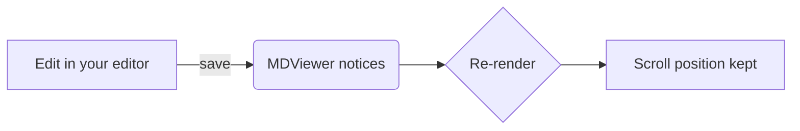

# MDViewer Help

MDViewer shows Markdown files and keeps them up to date while you edit them in another app.

> [!TIP]
> To open Markdown files with MDViewer when you double-click them, choose **MDViewer ▸ Settings…** and click **Make Default**. (Or in Finder: select a `.md` file, choose **File ▸ Get Info**, pick MDViewer under **Open with**, then click **Change All…**.)

## Opening files

- Double-click a Markdown file in Finder (once MDViewer is set as its app), or drop it on the Dock icon.
- **File ▸ Open…** (⌘O), or **File ▸ Open Recent**.
- To tidy up the recent files, use **File ▸ Open Recent ▸ Clear Menu**, or in the start window hover over a file and click **×** (or click **Clear** to remove them all).
- Drag files onto any MDViewer window.
- From Terminal: `open -a MDViewer README.md`.

Each file opens in its own window. To get tabs instead, set **System Settings ▸ Desktop & Dock ▸ Prefer tabs when opening documents** to *Always*, or use **Window ▸ Merge All Windows**.

## Keyboard shortcuts

| Action | Shortcut |
|---|---|
| Open | ⌘O |
| Find / next / previous | ⌘F / ⌘G / ⇧⌘G |
| Toggle sidebar | ⌃⌘S |
| Summarize (TL;DR) | ⇧⌘S |
| Zoom in / out / actual size | ⌘= / ⌘− / ⌘0 |
| Back / forward | ⌘[ / ⌘] |
| Reload | ⌘R |
| Reveal in Finder | ⇧⌘R |
| Open in Editor | ⌘E |
| Copy file path | ⌥⌘C |
| Copy as rich text | ⌥⇧⌘C |
| Print | ⌘P |

## Sharing a document

- **File ▸ Export as PDF…** saves a paginated PDF, laid out like a printout.
- **File ▸ Export as HTML…** saves a single web page with everything embedded (styles, math fonts, diagrams, images), so it opens anywhere, even offline.
- **Edit ▸ Copy as Rich Text** copies the selection, or the whole document when nothing is selected, so it pastes with its formatting into Mail, Pages, Google Docs or Slack. Math is pasted as TeX.

Hover over a link to see where it goes in the bottom-left corner of the window. Hold ⌘ to open it in a new window.

## AI summaries (TL;DR)

For long documents, such as the ones AI coding agents write, choose **View ▸ Summarize** (⇧⌘S) or click the summary button at the top right of the window. A short summary appears above the document, with links to the sections it comes from. It's kept with the file, and if the file changes, the summary offers to update.

Set it up in **MDViewer ▸ Settings… ▸ AI Summary**:

- **Provider.** Use your own API key with OpenRouter (one key for models from many companies), OpenAI, Anthropic, Google Gemini, xAI Grok, Mistral, DeepSeek or Groq. Or run a model on this Mac with Ollama or LM Studio, so documents never leave it. **Custom** works with any other OpenAI- or Anthropic-compatible service.
- **API key.** Stored in your macOS keychain and only sent to that provider. MDViewer only goes to the keychain when you save a key or use it, so macOS may ask then to let it in: choose **Always Allow**. As MDViewer isn't signed by Apple, macOS asks again after each update.
- **Model.** Pick one from the provider's list, or type its name.
- **Instructions.** Describe what the summary should contain and how long it should be. MDViewer adds the document and the links to its sections.

A document is only sent when you ask for a summary, and MDViewer asks before the first time for each provider. Documents too long for the model are read in parts, then summarized from notes on each part.

## Quick Look

Select a Markdown file in Finder and press the space bar to preview it with MDViewer's rendering, diagrams and math included. Quick Look can only read the file itself, so images next to it are shown as their description.

## What gets rendered

GitHub-flavoured Markdown, including tables, ~~strikethrough~~, autolinks like https://example.com, and footnotes.[^1]

- [x] Task lists
- [ ] Unchecked items

```ts
// Syntax highlighting for 200+ languages
function greet(name: string): string {
  return `Hello, ${name}!`;
}
```

Math, inline like $e^{i\pi} + 1 = 0$ or as a block:

$$
\int_0^\infty e^{-x^2}\,dx = \frac{\sqrt{\pi}}{2}
$$

Mermaid diagrams:



> [!NOTE]
> Alerts like this one use GitHub's `> [!NOTE]` syntax. `[!TIP]`, `[!IMPORTANT]`, `[!WARNING]` and `[!CAUTION]` work too.

Links to other Markdown files open in the same window (⌘-click opens a new one). Links to websites open in your browser. Images next to the document, or anywhere in the same git repository, are shown.

[^1]: Like this one.
