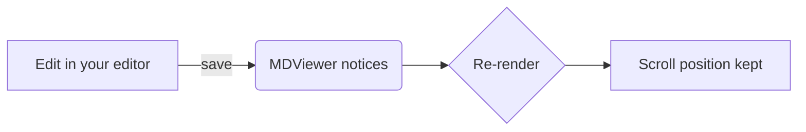

# MDViewer Help

MDViewer shows Markdown files and keeps them up to date while you edit them in another app.

> [!TIP]
> To open Markdown files with MDViewer when you double-click them, choose **MDViewer ▸ Settings…** and click **Make Default**. (Or in Finder: select a `.md` file, choose **File ▸ Get Info**, pick MDViewer under **Open with**, then click **Change All…**.)

## Opening files

- Double-click a Markdown file in Finder (once MDViewer is set as its app), or drop it on the Dock icon.
- **File ▸ Open…** (⌘O), or **File ▸ Open Recent**.
- To tidy up the recent files, use **File ▸ Open Recent ▸ Clear Menu**, or in the start window hover over a file and click **×** (or click **Clear** to remove them all).
- Drag files onto any MDViewer window.
- From Terminal: `open -a MDViewer README.md`.

Each file opens in its own window. To get tabs instead, set **System Settings ▸ Desktop & Dock ▸ Prefer tabs when opening documents** to *Always*, or use **Window ▸ Merge All Windows**.

## Keyboard shortcuts

| Action | Shortcut |
|---|---|
| Open | ⌘O |
| Find / next / previous | ⌘F / ⌘G / ⇧⌘G |
| Toggle sidebar | ⌃⌘S |
| Zoom in / out / actual size | ⌘= / ⌘− / ⌘0 |
| Back / forward | ⌘[ / ⌘] |
| Reload | ⌘R |
| Reveal in Finder | ⇧⌘R |
| Open in Editor | ⌘E |
| Copy file path | ⌥⌘C |
| Print | ⌘P |

## What gets rendered

GitHub-flavoured Markdown, including tables, ~~strikethrough~~, autolinks like https://example.com, and footnotes.[^1]

- [x] Task lists
- [ ] Unchecked items

```ts
// Syntax highlighting for 200+ languages
function greet(name: string): string {
  return `Hello, ${name}!`;
}
```

Math, inline like $e^{i\pi} + 1 = 0$ or as a block:

$$
\int_0^\infty e^{-x^2}\,dx = \frac{\sqrt{\pi}}{2}
$$

Mermaid diagrams:



> [!NOTE]
> Alerts like this one use GitHub's `> [!NOTE]` syntax. `[!TIP]`, `[!IMPORTANT]`, `[!WARNING]` and `[!CAUTION]` work too.

Links to other Markdown files open in the same window (⌘-click opens a new one). Links to websites open in your browser. Images next to the document, or anywhere in the same git repository, are shown.

[^1]: Like this one.
