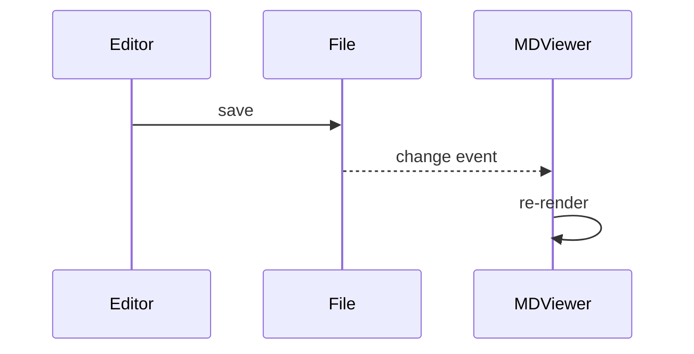

# Rich content




Inline math $a^2 + b^2 = c^2$ and a block:

$$
\sum_{n=1}^{\infty} \frac{1}{n^2} = \frac{\pi^2}{6}
$$

```rust
fn main() {
    let name = "world";
    println!("Hello, {name}!"); // comment
}
```

```python
def fib(n: int) -> int:
    return n if n < 2 else fib(n - 1) + fib(n - 2)
```

```
plain block without a language
```

- [Link to the other document](other.md#second-section)
- [External link](https://example.com)
- [Anchor link](#rich-content)
- [Missing file](does-not-exist.md)

<details><summary>Raw HTML details</summary>Hidden content <kbd>⌘</kbd> <kbd>K</kbd></details>

 <script>alert(2)</script>

> [!WARNING]
> Scripts in documents never run.
